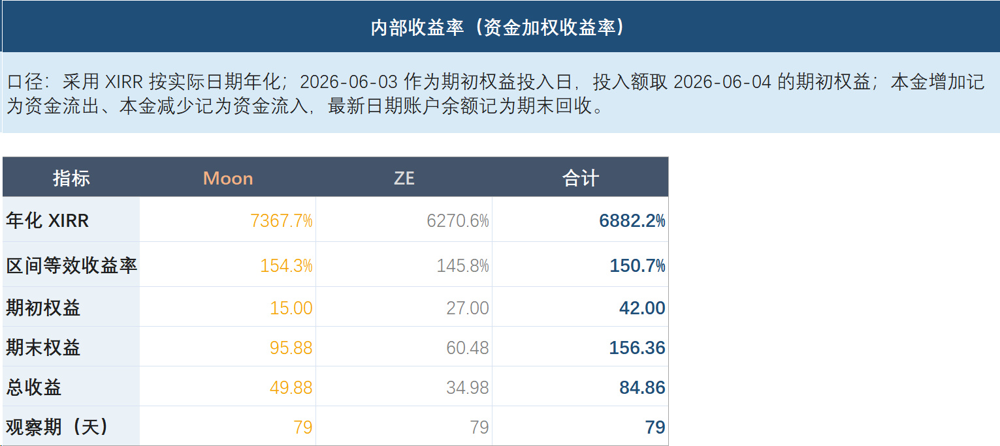
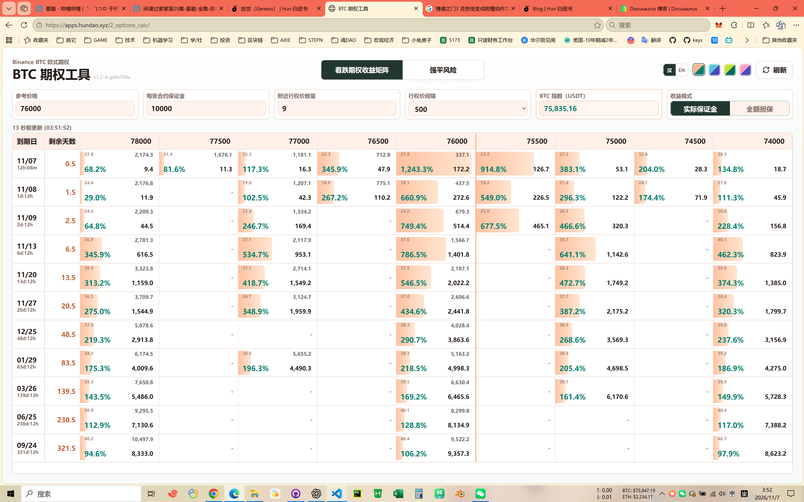
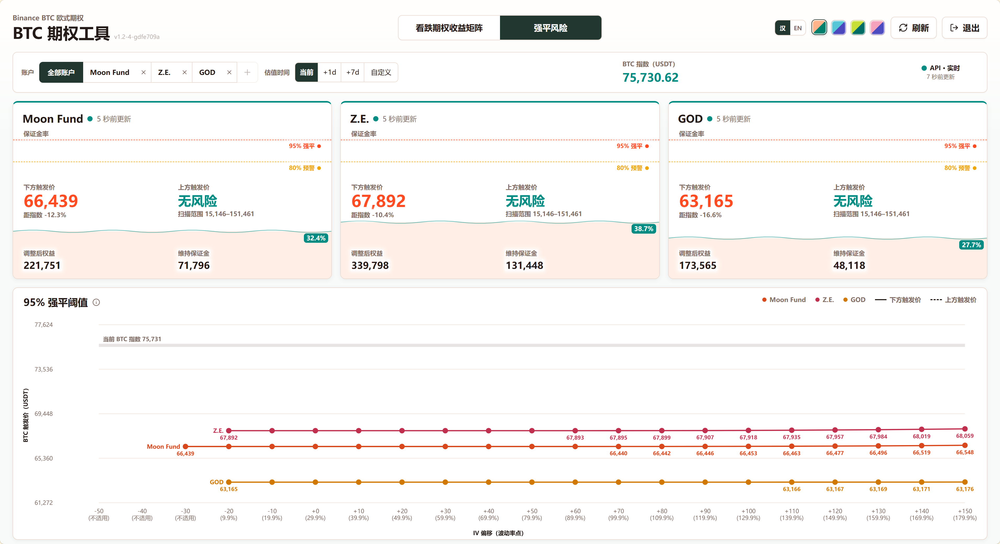
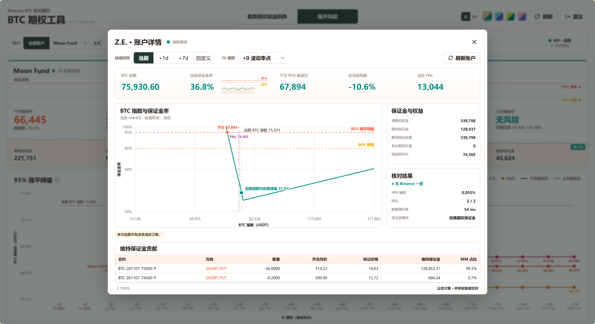
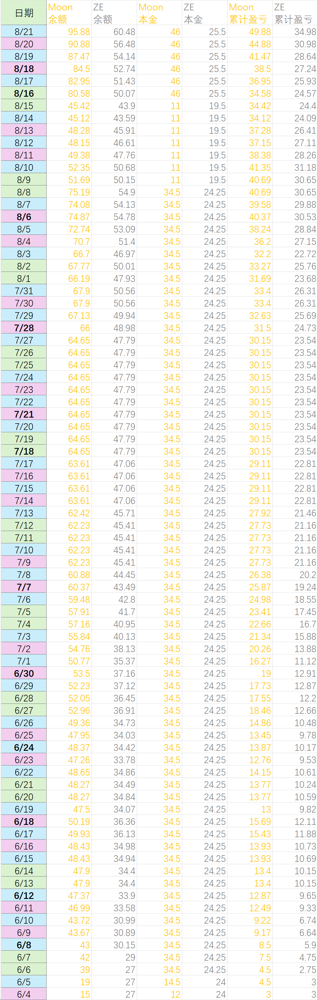

<!-- @format -->

**分享一下我的币圈熊市赚钱神器——信仰担保看跌期权策略**

硬核，指路文，不懂别效仿，且本轮时机已过，只分享是怎么回事，希望有启发。  
小小的善意也许能成就有心人。因为我当初也是看了段永平分享他做这策略建仓，仔细学习研究了，才有了现在这种适合自己的，**币圈熊市**的期权策略。感谢所有愿意分享的人。  
以下是两个号本轮熊市实际收益，单位已隐去。

<!-- truncate -->

## 理论

本来应该是“现金担保看跌期权策略”，就是一手备着足够的现金，一手在期望建仓价格（指数价格）卖出看跌期权，到期未行权就赚权利金，到期行权就变成以约定好的指数价格建仓了，且也赚了权利金。

但由于我是在币安做BTC期权，目前是欧式期权，且只以USDT唯一担保和结算，不涉及实物（BTC）交割，所以和传统金融的期权有较大不同。这里我就不细说了，自行了解清楚。

反正呢，有好处也有不便。不便是，行权时需要自行把“现金担保”那头建仓，才是完整“现金担保看跌期权策略”；好处是，可以不用这个策略了，用我自己的“信仰担保看跌期权策略”——说人话就是赌底部，再加“硬吃亏损不建仓”，再通过类似“展期”的操作把亏损延后，直到价格回到指数价格之上，就又赚钱了，不实物建仓。

听起来就是投机，只不过成功了而已。

当然不是。

为什么叫“信仰担保看跌期权策略”，就因为实际上开的仓位比现金能担保的更多，所以是“信仰担保”了，通过控制强平线来控制风险。我因此还开发了一个工具来看强平风险，主要看实际仓位的强平价格。当然还有看收益矩阵功能。（[开源了](https://github.com/HunDaoLtd/OptionsCalc)）

有朋友就笑了，你咋这么虎，敢信仰担保？不怕跌破强平价爆仓？

这就是纯信仰了，信自己的幂律模型。当年我费劲拟合出这个模型，惊讶地发现和物理学家 [Giovanni](https://x.com/Giovann35084111) 提出的 BTC_POWER_LAW 一模一样。数年后，我意识到世界的本质就是幂律的，就因为正反馈（偏好依附）和负反馈（自组织临界）。举几个例子，城市人口、财富、影响力、AI大模型、语言、森林火灾、病毒扩散、甚至超市货架商品价格数字是几开头的，都是幂律的。总而言之，我觉得[幂律模型](https://www.mnav.com/charts/bitcoin-power-law#x=log&y=log&h=15&ma=on)靠谱。放两篇文章备忘：

- [Bitcoin’s natural long-term power-law corridor of growth](https://medium.com/quantodian-publications/bitcoins-natural-long-term-power-law-corridor-of-growth-649d0e9b3c94)
- [Bitcoin’s power-law really debunked?](https://medium.com/quantodian-publications/bitcoins-power-law-really-debunked-2e5add103ba9)

再分享个核武器：**确定性**是投资的基石，是投资的第一性原理。  
确定性高的一定是好投资，确定性低到期望不及成本就是投机。只不过对于投资的确定性过于主观，还是有门槛的，基石却是幻影。但于我而言，幂律模型已是极强的确定性，更何况还有个更强的确定性——通胀永远存在（参见我《富人秘籍》一文）。

以上就是我信仰担保的基础。

## 实践

具体操作我就不细说了，免得诱人邯郸学步栽跟斗。大体描述下，足够有心人学会和避坑了。

- **基操**：卖出BTC看跌期权，指数价格选你认为的底部，日期我一般在熊底时选一天的或收益率最高的；像现在回调底部或预期近日要涨的，会多开几天。币安担保品公式较复杂不适合心算，我一般毛估一万U开一张（BTC 6~8万），会比实际有富余（正好降保证金率）。熊市底我会把保证金率放得比较高，50%以上，但会极度关注强平价格（目前币安没这功能，得自己算），因为参考的是“信仰底”——幂律模型价格。非熊底时期由于不确定性大了很多，我只会像截图中那样占用百分之三四十保证金率，以免强平（强平价格极差，凭空多亏两三成，别问我怎么知道的）。

- **亏损处理**：币价在底部的机会很少，大部份时间在上方，这时开底部的价格还是现价附近，是个决择。我的风格是以收益对冲风险，开期权的时候选现价附近收益率高的，就算亏了也能用高收益率覆盖亏损。但你总会遇到暴跌的，这时的亏损一定要处理好。原理就是它是一种“无常损失”，也就是说只要仓位一直开着，等回到这个价格了就不亏了。听着像句废话，但大多朋友栽在这里，划重点——**续开期权的指数价格一定要与亏损那单一致**（开更高流动性差，仓位大的让价太多），不然暴涨回去时，指数价格之上的部份你是没收益的！还有种策略是亏损就认了，继续开高收益率的。两个策略谁更好，取决于扛单时间，像扛一周就认亏更划算了。

- **挂单吃单**：十几张的不用考虑，就币安目前的流动性，二三十张往上就最好吃单了，除非你愿意让价很多。比如你500刀挂了三十张，我遇到过公允价550了（折价50刀）做市商还不吃我，但你一撤单，盘口就到540了，你再去吃540的单就好。挂单的话一般用在等大波动上，也经常有天降横财。我们每次都调侃“等天黑”（每天16点行权开始开单，我一般在0点前开完），先挂个离谱的价格等发财，等不到了再成交个实现的价格。心得是宁可少赚也不要空军。

- **资金来源**：当然是你自己的。我是满仓党，手里全是现货，就去质押借贷/VIP借贷，熊底质押率五六成很安全，利率3%左右。胆子肥的信仰担保，保守的就现金/合约担保，意思是在跌下来时可以真实建仓。合约担保的话，币本位杠杆倍率2倍极限了，关注强平价，**绝对绝对**要做好止损（这也是我最值钱的认知之一，当时币价6万多我挂5万止损）。

- **其他**：Moon是我管理的基金，操作更保守，另一个是我自己的号，因为本金少更为激进。明显看出，激进不等于赚钱。因为等待本身，也是赚钱的一种方式。我现在开始学会了。

最近我为7.5W加仓大饼，就陆陆续续又做了几次，有看懂了的朋友可以小试牛刀。

这些都只是我们自行摸索的经验之谈，非专业人士。  
这个策略开单天数全加一起，我也才做了三个月。非常适合我在熊市盈利和建仓，但是很累，压力很大。现在我把这个方法写篇文章分享一下，主要面向愿意刻苦学习的朋友，所以，不懂别问我。  
文未附张当时的记录明细。

